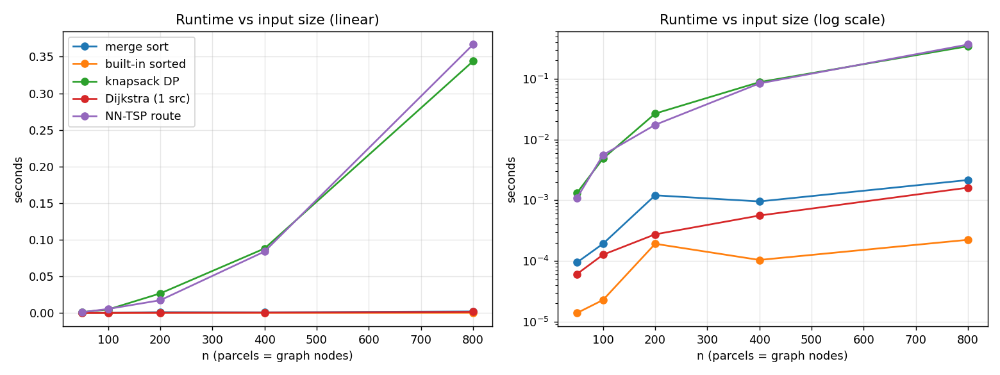

# Mini-Courier Planner: An Integrated Algorithmic Delivery Planning System

**Capstone Assignment Report**

| | |
|---|---|
| **Name** | Dhruv Jaiswal |
| **Roll No.** | 2501730364 |
| **Course** | Design & Analysis of Algorithms (ETCCDA302) |
| **Programme** | B.Tech CSE & Specializations |
| **Institution** | K.R. Mangalam University |


---

## Abstract

Courier companies must decide, for every trip, which parcels to load, in what order to prioritise them, and which route the vehicle should follow. This project presents the Mini-Courier Planner, a Python prototype that answers these three questions by integrating four classical algorithmic techniques: **merge sort** (parcel prioritisation by deadline), **0/1 knapsack dynamic programming** (optimal selection of parcels under a weight limit), **Dijkstra's algorithm** (shortest paths on the road network) and the **nearest-neighbour heuristic** (an approximation for the NP-hard Travelling Salesman Problem). The system was tested for correctness against brute-force solutions on 20 random instances each, and benchmarked on inputs of 50 to 800 parcels. The knapsack DP matched the brute-force optimum in every test, and the nearest-neighbour route was on average 1.068 times the optimal length (worst case 1.260). Runtime measurements show that the knapsack step dominates the pipeline as input grows, while sorting and Dijkstra scale almost linearly. The report discusses the design, implementation, complexity analysis, results and possible optimisations.

**Keywords:** merge sort, dynamic programming, 0/1 knapsack, Dijkstra, TSP, nearest neighbour, algorithm analysis

---

## Table of Contents

1. Introduction
2. Problem Statement and Objectives
3. System Design (Phase 1)
4. Package Prioritisation and Box Filling (Phase 2)
5. Route Maker and Graph Processing (Phase 3)
6. Performance Testing and Optimisation (Phase 4)
7. Results and Discussion (Phase 5)
8. Limitations
9. Conclusion and Future Work
10. Project Structure and Execution Steps

---

## 1. Introduction

Last-mile delivery is one of the most expensive parts of logistics. A dispatcher has limited vehicle capacity, parcels with different urgency and value, and a road network with different travel times. Poor decisions lead to late deliveries, wasted capacity and longer routes.

These decisions map naturally onto well-known algorithmic problems:

| Real-world decision | Algorithmic problem |
|---|---|
| Which parcels are most urgent? | Sorting |
| Which parcels fit in the van for the best total value? | 0/1 knapsack (dynamic programming) |
| How far is it between two locations? | Single-source shortest path |
| In what order should customers be visited? | Travelling Salesman Problem (approximation) |

This project combines these into one pipeline, which also lets the algorithms be compared in terms of time complexity and measured runtime.

## 2. Problem Statement and Objectives

**Problem statement.** Given a list of parcels and a road network of delivery points, generate an ordered delivery route and an optimised packing plan for one delivery trip.

**Objectives**

1. Design the data model for parcels, delivery points and the road graph.
2. Prioritise parcels using an efficient sorting algorithm.
3. Select the best set of parcels for one trip using dynamic programming.
4. Compute shortest paths using Dijkstra's algorithm and build the final route using a TSP approximation.
5. Test on small and large datasets, record runtimes and suggest optimisations.
6. Document and demonstrate the working system.

## 3. System Design (Phase 1)

### 3.1 Data design

**Parcel**

| Attribute | Type | Meaning |
|---|---|---|
| `pid` | int | Unique parcel ID |
| `weight` | int (kg) | Weight; integer so it can index the DP table |
| `value` | int | Priority / revenue score (higher is more important) |
| `deadline` | int (hours) | Time left to deliver (smaller is more urgent) |
| `dest` | int | Node ID of the delivery point in the graph |

**Road graph.** An undirected, weighted graph stored as an adjacency list `{u: [(v, travel_time), ...]}`. Node 0 is the depot where every trip starts and ends. Edge weights are positive integers (travel time), which is the condition required by Dijkstra's algorithm. Test graphs are generated with a random spanning chain, which guarantees the graph is connected, plus extra random edges to create alternative routes. A fixed random seed makes every dataset reproducible.

**Capacity.** The vehicle has a single weight limit `W` (30 kg for the demo dataset).

### 3.2 Pipeline

```
 Parcels (id, weight, value, deadline, dest)
        |
        v
 [1] Merge sort by (deadline, -value)   -> ordered parcel list
        |
        v
 [2] 0/1 Knapsack DP, capacity W        -> parcels chosen for this trip
        |
        v
 [3] Collect destination nodes (stops)
        |
        v
 [4] Dijkstra from each stop            -> pairwise shortest distances
        |
        v
 [5] Nearest-neighbour TSP              -> route: depot -> stops -> depot
        |
        v
 Output: packing plan, route, route length, runtimes
```

### 3.3 Algorithm selection and justification

| Step | Algorithm | Justification | Time complexity |
|---|---|---|---|
| Prioritise | Merge sort | Stable, guaranteed O(n log n) in all cases; stability keeps equal-key parcels in input order | O(n log n) |
| Pack | 0/1 knapsack DP | Parcels cannot be split, and a greedy choice by value or ratio is not always optimal, so DP is needed for the optimum | O(nW) time and space |
| Shortest path | Dijkstra with binary heap | Edge weights are non-negative; efficient on sparse road networks | O((V+E) log V) |
| Route | Nearest neighbour | TSP is NP-hard, so exact solutions are impractical for many stops; this gives a fast approximate tour | O(k (V+E) log V) for k stops |

## 4. Package Prioritisation and Box Filling (Phase 2)

### 4.1 Sorting

Parcels are sorted by **earliest deadline first**, with ties broken by higher value, using the key `(deadline, -value)`. A custom stable merge sort was implemented: the list is split in half recursively, each half is sorted, and the halves are merged by repeatedly taking the smaller front element. It runs in O(n log n) time and O(n) extra space.

Sorted order for the demo dataset (10 parcels):

| Rank | Parcel | Weight (kg) | Value | Deadline (h) | Destination |
|---|---|---|---|---|---|
| 1 | P2 | 15 | 77 | 2 | 7 |
| 2 | P4 | 15 | 30 | 8 | 3 |
| 3 | P9 | 13 | 19 | 9 | 5 |
| 4 | P8 | 3 | 59 | 11 | 7 |
| 5 | P6 | 2 | 83 | 16 | 1 |
| 6 | P5 | 8 | 41 | 25 | 5 |
| 7 | P7 | 12 | 37 | 27 | 3 |
| 8 | P3 | 8 | 41 | 42 | 1 |
| 9 | P1 | 13 | 98 | 48 | 6 |
| 10 | P0 | 10 | 42 | 48 | 3 |

P1 and P0 share a deadline of 48 hours, and P1 comes first because its value (98) is higher.

### 4.2 Dynamic programming: 0/1 knapsack

Let `dp[i][w]` be the best total value obtainable using the first `i` parcels with weight limit `w`.

- Base case: `dp[0][w] = 0` for all `w`.
- Recurrence: `dp[i][w] = dp[i-1][w]` if parcel `i` does not fit; otherwise `dp[i][w] = max(dp[i-1][w], dp[i-1][w - weight_i] + value_i)`.
- The answer is `dp[n][W]`.
- **Backtracking:** starting at `(n, W)`, if `dp[i][w] != dp[i-1][w]` then parcel `i` was taken, so subtract its weight and continue upward. This recovers the chosen set.

The complete table is kept (not just one row) so it can be shown as evidence and used for backtracking.

**Result (capacity 30 kg):** optimum value **282**, selected parcels **P8, P6, P1, P0**, total weight **28 / 30 kg**.

Note that the most urgent parcel P2 (15 kg, deadline 2 h) is not selected. The knapsack here maximises total value only and does not treat the deadline as a constraint. This is a deliberate simplification noted in Section 8.

## 5. Route Maker and Graph Processing (Phase 3)

### 5.1 Dijkstra's algorithm

Dijkstra's algorithm maintains a distance estimate for every node, initially infinity except the source (0). A min-heap holds `(distance, node)` pairs. The closest unprocessed node is popped, and each neighbour is relaxed: if going through the popped node is shorter, the neighbour's distance is updated and it is pushed onto the heap. Stale heap entries are skipped. A parent pointer per node allows the actual path to be reconstructed. Complexity is O((V+E) log V).

### 5.2 Nearest-neighbour TSP approximation

Starting from the depot, the vehicle repeatedly drives to the **closest unvisited stop** (distance taken from Dijkstra, so it respects the real road network rather than straight lines) until all stops are visited, then returns to the depot. Dijkstra results are cached per stop so each source is computed once. The overall cost is k Dijkstra runs for k stops.

The nearest-neighbour heuristic has no constant approximation guarantee in general (its worst-case ratio grows logarithmically with the number of stops on metric instances), but it is simple and fast and usually performs well in practice, as the tests in Section 6 show.

### 5.3 Result on the demo dataset

- Stops (destinations of the selected parcels): nodes **7, 1, 6, 3**
- Route: **0 -> 7 -> 1 -> 6 -> 3 -> 0**
- Route length: **37** time units
- Full road-level path (including intermediate nodes): 0 -> 7 -> 2 -> 1 -> 6 -> 3 -> 5 -> 0

The expanded path shows that the vehicle passes through nodes 2 and 5, which are not delivery points but lie on the shortest roads between stops.

## 6. Performance Testing and Optimisation (Phase 4)

### 6.1 Correctness testing

| Test | Method | Result |
|---|---|---|
| Knapsack | Compared with brute force over all subsets, 20 random instances of 10 parcels | All 20 matched |
| Merge sort | Compared with Python's built-in `sorted` using the same key, 20 random instances | All 20 matched |
| NN-TSP quality | Compared with the optimal tour from brute-forcing all permutations (6 stops, 12 nodes), 20 instances | Average ratio **1.068**, worst **1.260** |

On average the heuristic route is about 7% longer than optimal, and in the worst tested case 26% longer.

### 6.2 Runtime benchmark

Each step was timed on random datasets with n parcels and n nodes. The knapsack capacity was scaled with n (capacity = 2.5n kg).

| n | Merge sort (s) | Built-in sorted (s) | Knapsack DP (s) | Dijkstra, 1 source (s) | NN-TSP route (s) |
|---|---|---|---|---|---|
| 50 | 0.000074 | 0.000011 | 0.001015 | 0.000050 | 0.001104 |
| 100 | 0.000153 | 0.000022 | 0.004259 | 0.000095 | 0.003491 |
| 200 | 0.000346 | 0.000046 | 0.017892 | 0.000238 | 0.014254 |
| 400 | 0.000778 | 0.000148 | 0.075121 | 0.000731 | 0.066644 |
| 800 | 0.001711 | 0.000194 | 0.328760 | 0.001233 | 0.309874 |

Exact times vary slightly between runs and machines, but the trends are stable. The runtime chart is saved as `runtime_chart.png`.



### 6.3 Analysis

- **Knapsack DP dominates.** Its time grows by roughly 4 times each time n doubles. This is expected because the table has n x W cells and W was scaled with n, making the work quadratic in n. This is a pseudo-polynomial algorithm: its cost depends on the numeric value of the capacity, not just the input count.
- **Merge sort** roughly doubles when n doubles, consistent with O(n log n).
- **Dijkstra** also scales close to linearly with graph size on these sparse graphs.
- **NN-TSP route time** is similar to the knapsack time at these sizes because the number of stops (and so Dijkstra calls) grows with n. It is the second most expensive step.
- **Custom merge sort vs built-in sorted.** The built-in Timsort is about 8 to 9 times faster at n = 800. Both are O(n log n); the difference is that Timsort is implemented in C while the custom version runs in interpreted Python. The custom version was written to demonstrate the algorithm.

### 6.4 Suggested optimisations

1. **Reduce knapsack memory** to O(W) using a single rolling array, if only the optimal value is needed (backtracking then requires storing decisions, for example in a bitset).
2. **Vectorise the DP** with NumPy so each row update is one array operation instead of a Python loop.
3. **Improve the route with 2-opt**: after the nearest-neighbour tour, repeatedly reverse segments that shorten it. This typically removes much of the gap to optimal.
4. **Avoid repeated Dijkstra work** by running it only from stops and the depot, which the implementation already does through caching, or by using a Fibonacci/pairing heap for very dense graphs.
5. **Include deadlines in the optimisation**, for example by treating urgent parcels as mandatory in the knapsack or by ordering the route to meet deadlines.

## 7. Results and Discussion (Phase 5)

The system produces, for a given dataset, the sorted parcel list, the optimal parcel set with its total value and weight, the ordered route with its length, the full road path, and per-step runtimes.

**Demo dataset summary (10 parcels, 8 nodes, 30 kg):**

| Item | Value |
|---|---|
| Parcels selected | P8, P6, P1, P0 |
| Total value | 282 |
| Load | 28 / 30 kg |
| Route | 0 -> 7 -> 1 -> 6 -> 3 -> 0 |
| Route length | 37 |

**Large dataset (500 parcels, 200 nodes):** the pipeline produced a route through 22 delivery stops of length 377, and all steps completed in a few milliseconds (sort about 1 ms, knapsack about 2 ms, route about 4 ms).

**Screenshots / output traces** (insert your own below):

- Figure 1: `python courier_planner.py small.json`
- Figure 2: `python courier_planner.py large.json`
- Figure 3: `python benchmark.py` terminal output
- Figure 4: `runtime_chart.png`

Overall, the results confirm that each algorithm suits its role: the DP gives a provably optimal packing, Dijkstra gives exact shortest distances, and the heuristic gives a good route quickly where an exact TSP solution would be too expensive.

## 8. Limitations

- The knapsack maximises value and uses deadlines only for sorting, so an urgent parcel can be left behind (as P2 was in the demo).
- The model has one vehicle, one weight constraint (no volume) and one trip.
- Nearest neighbour is a heuristic and can produce routes noticeably longer than optimal.
- Weights must be integers for the DP table approach.
- The datasets are synthetic, not real road data.

## 9. Conclusion and Future Work

The Mini-Courier Planner shows how sorting, dynamic programming, shortest-path search and approximation can be combined into one working planning system. The implementation was verified against brute-force baselines, and benchmarking identified the knapsack DP as the main cost as inputs grow. Future work could add deadline-aware selection, multiple vehicles and trips, volume constraints, 2-opt route improvement, real map data, and a simple graphical interface.

## 10. Project Structure and Execution Steps

```
courier_planner.py    Main system (all four algorithms + pipeline)
benchmark.py          Correctness tests, runtime benchmark, chart
report.md             This report
README.md             Short documentation
small.json            Demo dataset (10 parcels, 8 nodes)
large.json            Large dataset (500 parcels, 200 nodes)
output                Run traces, benchmark results, runtime_chart.png
```

**To run** (from the project folder; Python 3.8+):

```
python courier_planner.py data/small.json
python courier_planner.py data/large.json
pip install matplotlib
python benchmark.py
```

